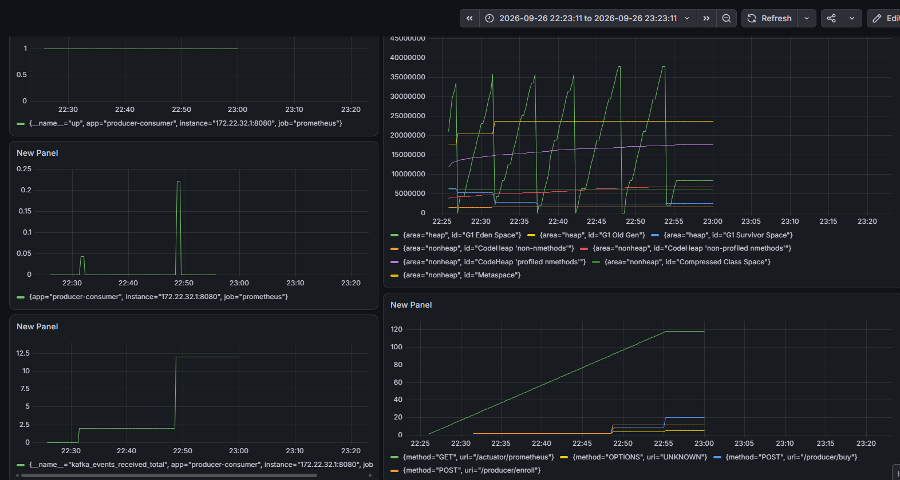

# kafka_project

Course landing page plus a Spring Boot service that publishes user actions to **Kafka**. **Prometheus** scrapes the app. **Grafana** graphs the metrics.

```text
React (landing page)
    → POST /producer/buy  or  /producer/enroll
        → Kafka topics
            → Spring consumer (Micrometer counter)
                → /actuator/prometheus
                    → Prometheus
                        → Grafana
```

This repo is the **app code**. Kafka, Prometheus, and Grafana are installed on the machine (for example Ubuntu in WSL). They are not in this GitHub tree.

---

## Repo layout

```text
BackEnd/ProducerConsumer/   Spring Boot 3 (Java 25) — producer + consumer + Actuator
FrontEnd/landing-page/      React landing page
docs/                       screenshots
```


---

## What we observed (Grafana)

Live dashboard from a working run:



| Panel | What it showed | Meaning |
|---|---|---|
| `up` | Flat line at **1** | Prometheus can scrape the Spring app. This is health, not traffic. |
| `kafka_events_received_total` | Steps up (about **0 → 12**) | Consumer handled Kafka messages. Spikes on the tiny rate-style panel are the same increments. |
| JVM heap / Metaspace | Sawtooth / GC spikes | Normal JVM memory. Eden space jumping is garbage collection, not a Kafka outage. |
| HTTP requests | GET `/actuator/prometheus` climbing; POST `/producer/buy` and `/producer/enroll` stepping up | Prometheus scrape traffic plus real Buy / Enroll clicks. |

**Queries that work** (job label is `prometheus` if the scrape job was folded into the default job):

```promql
up{app="producer-consumer"}
kafka_events_received_total
rate(kafka_events_received_total[1m])
http_server_requests_seconds_count
jvm_memory_used_bytes
```

`up{job="course-platform"}` is empty unless `prometheus.yml` uses that `job_name`.

Start order: **Kafka → Spring Boot → Prometheus → Grafana**. If the app is down, `up` drops and Grafana shows No data.

---

## Prerequisites

- Java 25
- Node.js (for the React app)
- Kafka 4.x (KRaft, no ZooKeeper) on Ubuntu/WSL, port **9092**
- Prometheus on Ubuntu, port **9090**
- Grafana on Ubuntu, port **3000**

---

## 1. Kafka (Ubuntu / WSL)

```bash
sudo systemctl start kafka
sudo systemctl status kafka
```

Create topics the producer uses:

```bash
export JAVA_HOME=/usr/lib/jvm/java-25-openjdk-arm64   # or your JDK path

sudo -u kafka env JAVA_HOME=$JAVA_HOME \
  /opt/kafka/bin/kafka-topics.sh --create --if-not-exists \
  --topic buy-course --bootstrap-server localhost:9092 \
  --partitions 1 --replication-factor 1

sudo -u kafka env JAVA_HOME=$JAVA_HOME \
  /opt/kafka/bin/kafka-topics.sh --create --if-not-exists \
  --topic enroll-now --bootstrap-server localhost:9092 \
  --partitions 1 --replication-factor 1
```

The consumer in this repo listens to topic `test`. If Buy/Enroll events do not move `kafka_events_received_total`, either produce to `test` or change the `@KafkaListener` topic to match.

---

## 2. Backend

```bash
cd BackEnd/ProducerConsumer
```

**Do not put your WSL IP in git.** Set it only on your machine.

From Ubuntu:

```bash
hostname -I
```

PowerShell (this session), then run the app:

```powershell
$env:KAFKA_BOOTSTRAP_SERVERS="YOUR_WSL_IP:9092"
```

Or IntelliJ → Run configuration → Environment variables:

```text
KAFKA_BOOTSTRAP_SERVERS=YOUR_WSL_IP:9092
```

If the app runs **inside** the same Ubuntu as Kafka:

```text
KAFKA_BOOTSTRAP_SERVERS=localhost:9092
```

Start:

```bash
./gradlew bootRun
```

Windows: `gradlew.bat bootRun`

Check metrics (must be Prometheus text, not JSON):

```text
http://localhost:8080/actuator/prometheus
```

`application.properties` binds `0.0.0.0:8080` so WSL Prometheus can scrape Windows.

---

## 3. Frontend

```bash
cd FrontEnd/landing-page
npm install
npm start
```

Uses the landing pages that call the producer Buy / Enroll endpoints.

---

## 4. Prometheus (Ubuntu)

Scrape the **Windows** app from WSL. `localhost:8080` on Ubuntu is not the Spring app.

Use the Windows host address from Ubuntu (`ip route` default gateway), not the WSL DNS IP.

`/etc/prometheus/prometheus.yml` (example — replace `WINDOWS_HOST` ):

```yaml
scrape_configs:
  - job_name: "prometheus"
    static_configs:
      - targets: ["localhost:9090"]

  - job_name: "course-platform"
    metrics_path: "/actuator/prometheus"
    static_configs:
      - targets: ["WINDOWS_HOST:8080"]
        labels:
          app: "producer-consumer"
```

```bash
sudo systemctl start prometheus
```

UI: http://localhost:9090/targets — Spring job must be **UP**.

---

## 5. Grafana (Ubuntu)

```bash
sudo systemctl start grafana-server
```

- UI: http://localhost:3000  
- First login: `admin` / `admin`  
- **Connections → Data sources → Prometheus**  
- URL: `http://localhost:9090` (Grafana and Prometheus are both on Ubuntu)  
- **Save & test**

Graphs: **Explore** → run a query → **Add to dashboard**. Do not use dashboard **Settings → Variables** for this.

---

## Ports

| Service | Port |
|---|---|
| Spring Boot | 8080 |
| Kafka | 9092 |
| Prometheus | 9090 |
| Grafana | 3000 |
| React | 3000 on Windows (if Grafana is only in WSL, they do not clash) |

---

## Daily start

1. `sudo systemctl start kafka prometheus grafana-server`  
2. Set `KAFKA_BOOTSTRAP_SERVERS`  
3. Start Spring Boot  
4. Start React if you need the UI  
5. Open Grafana and use Last 15 minutes  

---


